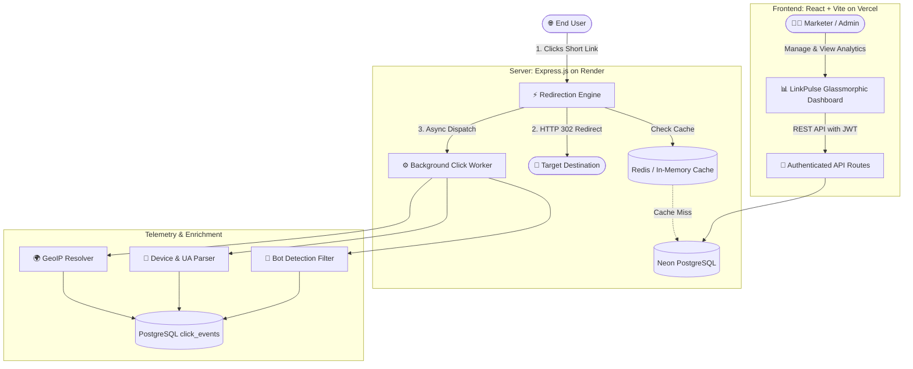

<div align="center">

# ⚡ LinkPulse

### **Enterprise URL Gateway, Dynamic QR Engine & Real-Time Analytics Platform**
*Developed by Team **PLATFORM404***

[](https://link-pulse-delta.vercel.app)
[](https://linkpulse-fbk6.onrender.com/health)
[-00E699?style=for-the-badge&logo=postgresql)](https://neon.tech)
[](LICENSE)

[🌐 Live Project Demo](https://link-pulse-delta.vercel.app) • [📖 API Documentation](#-api-endpoints) • [🛠️ Architecture](#-system-architecture) • [🚀 Setup Guide](#-quick-start-local-development)

---

</div>

## 🎯 Problem Statement

Traditional URL shorteners simply truncate links without verifying their authenticity, security, or audience context. In modern web environments, teams and marketers face:
1. **Security & Phishing Risks**: Malicious destination URLs and chained shorteners mask malware distribution and credential harvesting.
2. **Data Distortion**: Bots, web crawlers, and preview scrapers artificially inflate click metrics, distorting campaign ROI.
3. **Lack of Actionable Attribution**: Marketers cannot differentiate between organic digital clicks, physical print scans, geographic origins, or device breakdowns without stitching multiple expensive SaaS tools together.
4. **Latency Penalties**: Synchronous telemetry collection causes sluggish redirection speeds, negatively impacting conversion rates.

---

## 💡 Our Solution: LinkPulse

**LinkPulse** is a full-stack, enterprise-grade link management and analytics platform engineered to act as a **smart gateway**. It combines sub-millisecond redirection with an asynchronous telemetry ingestion engine, automated cybersecurity risk scoring, crawler filtering, and dynamic branded QR code generation.

---

## 📸 Product Walkthrough & Screenshots

| 📊 Analytics Dashboard | 🔗 Link Management |
| :---: | :---: |
|  |  |
| *Real-time click trends, top performers, active links* | *Custom vanity aliases, status toggles, password locks* |

| 📱 Dynamic QR Code Studio | 📈 Deep Telemetry & Insights |
| :---: | :---: |
|  |  |
| *Custom branded colors, real-time preview, vector export* | *Geographical resolution, device split, bot filtering* |

---

## ✨ Key Features

### 🛡️ 1. Intelligent Security & URL Auditing
- **Real-Time Risk Scoring**: Scans destination URLs for chained shorteners (obfuscation attacks), malformed protocols, and suspicious redirect loops.
- **Phishing & Domain Shield**: Admin-configurable domain blocking system that halts malicious traffic before redirection.
- **Password Protection**: Encrypt sensitive links with industry-standard **bcrypt** hashing.
- **Expiration & Click Limits**: Set links to automatically expire after reaching a click threshold or timestamp.

### 📊 2. Deep Real-Time Analytics
- **Geo-Location Telemetry**: Country-level breakdown with IP-based spatial resolution (`geoip-lite`).
- **Device & Browser Fingerprinting**: Automated normalization of user agents into Mobile, Desktop, Tablet, and Browser distributions.
- **Automated Bot Filtering**: Strips out crawlers, scrapers, and preview bots (`isbot`) to preserve data integrity.
- **Referrer Tracking**: Categorizes traffic sources (Direct, Social, Search Engines, Referral domains).

### 🏷️ 3. Campaign & Tag Orchestration
- **Campaign Groups**: Group links under marketing initiatives (e.g., *Summer Launch*, *Twitter Ads*).
- **Multi-Tag Filtering**: Tag, search, and aggregate click data across multiple distributed links.
- **Custom Vanity Aliases**: Human-readable short codes (`/my-custom-name`).

### 📱 4. Dynamic QR Code Engine
- Real-time client-side QR generation with customizable error correction levels.
- Direct **SVG / PNG export** ready for print and digital marketing collateral.
- Built-in scan attribution tracking to isolate print vs. digital engagement.

### ⚡ 5. High-Throughput Redirection Engine
- Sub-millisecond lookup via **in-memory / Redis caching**.
- **Asynchronous Click Ingestion**: Click events are queued and written to PostgreSQL asynchronously by a background worker, ensuring zero latency penalty for end-users.

---

## 🏗️ System Architecture



---

## 🛠️ Technology Stack

| Layer | Technologies |
| :--- | :--- |
| **Frontend** | React 18, Vite, Vanilla CSS Design System, Responsive Glassmorphism |
| **Backend** | Node.js, Express, Helmet, CORS, Nanoid, Zod Validation |
| **Database** | PostgreSQL with `pgcrypto` UUIDs, Neon Serverless Postgres |
| **Security & Auth** | JWT (JSON Web Tokens), bcrypt hashing, Rate Limiting |
| **Telemetry** | `geoip-lite`, `ua-parser-js`, `isbot`, SHA-256 Visitor Hashing |
| **Deployment** | Vercel (Client SPA) + Render (API Server) + Neon (Cloud DB) |

---

## 🚀 Quick Start (Local Development)

### 1. Clone the repository
```bash
git clone https://github.com/SakshamPantola/PLATFORM404-LinkPulse.git
cd PLATFORM404-LinkPulse
```

### 2. Backend Setup
```bash
cd server
npm install
cp .env.example .env
```

Configure `server/.env`:
```env
PORT=3001
NODE_ENV=development
DATABASE_URL=your_postgres_connection_string
JWT_SECRET=your_jwt_secret_key
CLIENT_URL=http://localhost:5173
BASE_URL=http://localhost:3001
```

Run database migrations:
```bash
npm run migrate
```

Start the backend server:
```bash
npm run dev
```

### 3. Frontend Setup
In a new terminal:
```bash
cd client
npm install
```

Create `client/.env`:
```env
VITE_API_URL=http://localhost:3001
VITE_SHORT_BASE_URL=http://localhost:3001
```

Start the client:
```bash
npm run dev
```

Access the application at: `http://localhost:5173`

---

## 📡 API Endpoints

### 🔐 Authentication
- `POST /api/auth/register` — Register a new user account
- `POST /api/auth/login` — Authenticate and receive JWT
- `GET /api/auth/me` — Retrieve authenticated user profile

### 🔗 Link Management
- `POST /api/links` — Create a new short link (supports custom alias, password, expiration)
- `GET /api/links` — List all links with paginated search & tag filtering
- `GET /api/links/:id` — Get detailed configuration for a specific link
- `PATCH /api/links/:id` — Update destination, click limit, or status
- `DELETE /api/links/:id` — Permanently delete a short link

### 📈 Analytics & Metrics
- `GET /api/stats/overview` — High-level user metrics (total links, clicks, top referrers)
- `GET /api/stats/:linkId` — Granular telemetry (time-series, country breakdown, devices)

### ⚡ Redirection
- `GET /:shortCode` — Ultra-fast 302 redirect with asynchronous telemetry recording
- `POST /:shortCode/verify` — Password verification for protected links

---

## 👥 Team PLATFORM404

<div align="center">

<table>
  <tr>
    <td align="center" width="20%">
      <a href="https://github.com/SakshamPantola">
        <br />
        <sub><b>Saksham Pantola</b></sub>
      </a><br />
      <sub>🚀 Lead Full-Stack Architect</sub>
    </td>
    <td align="center" width="20%">
      <a href="https://github.com/nirmaytripathi">
        <br />
        <sub><b>Nirmay Tripathi</b></sub>
      </a><br />
      <sub>🎨 Frontend UI & QR Studio</sub>
    </td>
    <td align="center" width="20%">
      <a href="https://github.com/SarthakBhatt55">
        <br />
        <sub><b>Sarthak Bhatt</b></sub>
      </a><br />
      <sub>🗄️ Database & Migrations</sub>
    </td>
    <td align="center" width="20%">
      <a href="https://github.com/krish222334843">
        <br />
        <sub><b>Krishna Sijwali</b></sub>
      </a><br />
      <sub>🛡️ Security & Risk Scoring</sub>
    </td>
    <td align="center" width="20%">
      <a href="https://github.com/tiwaritushar02">
        <br />
        <sub><b>Tushar Tiwari</b></sub>
      </a><br />
      <sub>📊 Web Assets & Telemetry</sub>
    </td>
  </tr>
</table>

</div>

### 📋 Member Roles & Key Contributions

| Member | Role | Key Contributions & Modules Owned | GitHub Profile |
| :--- | :--- | :--- | :--- |
| **Saksham Pantola** | **Lead Full-Stack Architect & Deployment** | • End-to-end system architecture & repository orchestration<br>• Express REST API, JWT authentication & middleware design<br>• Multi-cloud production deployment (Render API + Vercel SPA + Neon DB) | [](https://github.com/SakshamPantola) |
| **Nirmay Tripathi** | **Frontend UI & Dynamic QR Studio** | • React client interface development & glassmorphic theme system<br>• Real-time Dynamic QR code studio (custom color palettes & ECC levels)<br>• Print/digital export engines (high-res SVG & PNG generation) | [](https://github.com/nirmaytripathi) |
| **Sarthak Bhatt** | **Database Engineering & PostgreSQL Migrations** | • Relational schema modeling with `pgcrypto` UUID keys<br>• Automated migration scripts & indexing strategies<br>• Redirection query optimization and connection pooling with Neon | [](https://github.com/SarthakBhatt55) |
| **Krishna Sijwali** | **Security, URL Risk Scoring & Bot Filtering** | • Automated destination URL risk calculation & threat scoring<br>• Crawler and web-scraper filtering engine (`isbot`)<br>• Phishing defense, domain blacklisting & bcrypt password protection | [](https://github.com/krish222334843) |
| **Tushar Tiwari** | **Web Assets, Layout & Telemetry Dashboard** | • Real-time analytics dashboard layout & data visualization components<br>• Geo-location distribution breakdown (`geoip-lite`) & device charts<br>• Asset preparation, documentation visuals & responsive mobile layouts | [](https://github.com/tiwaritushar02) |

---

## 🔒 Security Best Practices Implemented

- **Rate Limiting**: Defends authentication and redirection endpoints against brute-force attacks.
- **SQL Injection Prevention**: 100% parameterized queries via `node-postgres` (`pg`).
- **Strict Input Validation**: Zod schema enforcement across all payloads.
- **Defensive Headers**: Configured with `helmet` for defensive HTTP response headers.
- **Privacy First**: IP addresses are hashed using SHA-256 with rotating salts to ensure GDPR-friendly analytics.
